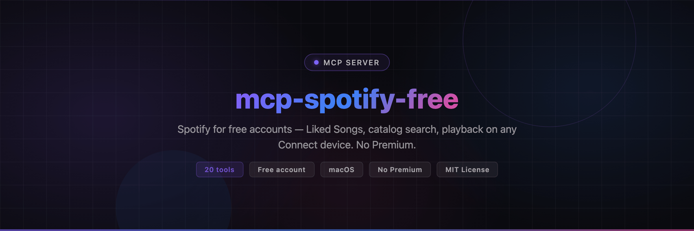

<!-- Banner -->
<p align="center">
  
</p>

<!-- Tagline -->
<p align="center">
  <strong>Spotify for free accounts — as an MCP server.</strong><br>
  Read your <em>Liked Songs</em>, search the whole catalog, and drive playback on
  <strong>any</strong> Spotify Connect device (Chromecast, TV, phone, desktop). No Premium.
</p>

<!-- Badges -->
<p align="center">
  <a href="https://github.com/vakandi/mcp-spotify-free"></a>
  <a href="https://www.npmjs.com/package/mcp-spotify-free"></a>
  <a href="https://github.com/vakandi/mcp-spotify-free/blob/main/LICENSE"></a>
  <a href="https://github.com/vakandi/mcp-spotify-free"></a>
  <a href="https://github.com/vakandi/mcp-spotify-free"></a>
  <a href="https://github.com/vakandi/mcp-spotify-free"></a>
</p>

---

## Why this exists

Spotify's public Web API hides the *Liked Songs* playlist behind Premium:
`GET /v1/me/tracks` answers **403** on a free account, and so does every
library-read endpoint built on it. Almost every "Spotify liked songs exporter"
on GitHub uses `spotipy.current_user_saved_tracks()` — Premium only.

The Spotify **web player** has no such restriction: it serves the full library
to free users. This server speaks the same internal protocol the web player
uses, so a free account gets:

- its complete *Liked Songs* playlist (591 tracks on the reference account)
- **catalog search** — the same search box as the web player (tracks, artists,
  albums, playlists, profiles), so any song can be played, not only the liked ones
- real playback control — play, pause, skip, volume
- **device switching** — send the sound to the Chromecast instead of the laptop

### Every other Spotify MCP server needs Premium (checked October 2026)

A sweep of the MCP registries and PyPI/GitHub found no other Spotify MCP
server that works on a plain free account. They all go through the official
Spotify Web API, which means a registered developer app + OAuth, and playback
is Premium-only — before Spotify tightened the API in February 2026, where the
app **owner must now hold Premium** and Dev Mode apps are capped at 5
authorized users. For example, quoting their own docs:

- `marcelmarais/spotify-mcp-server` — prerequisites: "A Spotify Premium
  account" + "A registered Spotify Developer application"
- `mcp-spotify` (PyPI) — "A Spotify Premium account (required by Spotify for
  Web API access)"
- `jamiew/spotify-mcp` — "Requires a Spotify Premium account"
- `mcp-server-spotify` (PyPI) / `leoalord/spotify-mcp-server` /
  `iceener/spotify-streamable-mcp-server` — bring your own developer app
  (client ID + secret + OAuth), Premium required for playback since Feb 2026

This server needs none of that: no developer app, no OAuth callback, no
client secret, no Premium. It reads the session cookies of a browser where
you are already logged in and speaks the web player's own protocol.

---

## Quick Start

### npx (recommended)

```bash
npx mcp-spotify-free
```

### npm install (global)

```bash
npm install -g mcp-spotify-free
mcp-spotify-free
```

### From source

```bash
cd ~/Documents/mcp-spotify-free
python3 -m pip install -r requirements.txt
python3 server.py login
```

---

## How it works

**1. Session (no password, no OAuth app, no Premium)**
The server reads the Spotify cookies of a browser where you are already logged
in (`open.spotify.com`), decrypts them locally with the macOS keychain
(`PBKDF2-HMAC-SHA1` + `AES-128-CBC`, the standard Chromium scheme), and
exchanges them for a short-lived user access token.

Two sources are tried, in order:
- `~/.config/mcp-spotify-free/cookies.json` — the captured session (works
  with the browser closed)
- the browser profile itself (Edge by default) — read straight from the
  Chromium cookie database, nothing is dumped or copied out

`spotify_session_status()` tells you which one is in use and whether Spotify
still accepts it.

**2. TOTP guard**
`open.spotify.com/api/token` is protected by a 6-digit TOTP
(HMAC-SHA1, 30 s period) whose secret is XOR-obfuscated inside the web-player
bundle. `spotify_free/totp.py` de-obfuscates it, re-reads the live bundle on
every run (the file name changes with every Spotify release — the current one
is looked up in the `open.spotify.com` HTML), and keeps a hardcoded fallback
so a network hiccup never breaks the server.

**3. Library**
`POST api-partner.spotify.com/pathfinder/v2/query` — the same GraphQL-ish
gateway the web player uses — with the `fetchPlaylistContents` operation and
the *Liked Songs* playlist alias `spotify:playlist:37i9dQZF1F5p3rmiWPIYgZ`
(also hardcoded in the web player, not account specific).

**4. Catalog search**
Same gateway, `searchTopResultsList` operation — the endpoint behind the
web player's search box. It works on a free account.

**5. Playback**
The Spotify Connect "harmony" command protocol:

```
POST connect-state/v1/player/command/from/{source}/to/{target}
PUT  connect-state/v1/connect/volume/from/{source}/to/{target}
```

Addressing the command to the Chromecast's device id *is* the "play on" — the
audio moves from the laptop to the TV.

**Device policy — the server leaves no trace**
The command protocol needs a *source* device. Registering one would add a
permanent entry ("MCP Spotify Free") to the account's device list, and every
crashed run would leave another ghost behind. Instead the server **reuses the
account's own web-player device** (`Web Player (Microsoft Edge)`) as the
source: the commands are accepted exactly the same way, and nothing is added
to the device list. Only if no web-player device exists does the server
register one — with a **stable, persisted device id**, so even then the list
never grows beyond a single entry.

`cleanup_devices()` removes the entries left by earlier versions. It uses
`DELETE /connect-state/v1/devices/{id}`, which drops the entry from the
account's device list immediately (the `hobs_` variant only drops the
subscription and leaves a visible ghost for hours).

---

## IDE Integration

### Cursor / Windsurf / VS Code

```json
{
  "mcpServers": {
    "spotify-free": {
      "command": "npx",
      "args": ["mcp-spotify-free"]
    }
  }
}
```

### Claude Desktop

```json
{
  "mcpServers": {
    "spotify-free": {
      "command": "npx",
      "args": ["mcp-spotify-free"]
    }
  }
}
```

### OpenCode / Claude Code

```bash
claude mcp add spotify-free --scope user -- npx mcp-spotify-free
```

### Through `mcp-cli` (this machine)

The server is registered in `~/.config/mcp/mcp_servers.json` under
`spotify-free`, so it is reachable through the `mcp-cli` wrapper:

```bash
mcp-cli info spotify-free                                  # list the tools
mcp-cli call spotify-free spotify_status '{}'               # account + devices
mcp-cli call spotify-free play_song '{"query":"one more time","device":"Chromecast"}'
mcp-cli call spotify-free cleanup_devices '{}'              # drop leftover devices
```

---

## Tools

- **`get_docs()`** — the full usage guide, returned as one big text. Start here.
- **`spotify_status()`** — account, token state, liked-song count, now playing,
  every Connect device.
- **`list_liked_songs(limit, offset, query)`** — the Liked Songs playlist,
  newest first. With `query` the whole library is scanned.
- **`search_liked_songs(query, limit)`** — only the matches, whole library.
- **`search_spotify(query, limit)`** — the **whole catalog**: tracks, artists,
  albums, playlists, profiles.
- **`play_song(query, device, index)`** — *the main one*: looks the title up in
  the Liked Songs, falls back to the catalog, and plays the best match.
  `source` in the answer tells you where the match came from.
- **`play_liked_song(query, device, index)`** — Liked Songs only.
- **`play_track(uri, device)`** — play a raw `spotify:track:...` URI.
- **`chromecast_sent(track_query, action)`** — the shortcut: always the
  Chromecast. `action` = `play` / `resume` / `pause` / `next` / `previous`.
- **`pause_playback(device)`** / **`resume_playback(device)`**
- **`skip_next(device)`** / **`skip_previous(device)`**
- **`set_volume(level, device)`** — 0-100.
- **`list_devices()`** — every Connect device with its volume and active flag.
- **`now_playing()`** — current track, playing/paused, position, active device.
- **`cleanup_devices()`** — remove the leftover `MCP Spotify Free` Connect
  devices of the earlier versions.
- **`spotify_session_status()`** — diagnose the session.
- **`spotify_login()`** / **`spotify_logout()`** — capture / forget the session.

Every tool returns a structured payload: `ok`, `action`, plus the relevant
data — and on failure `error` with a human-readable cause. When the failure is
the session (bad or expired browser cookies, `401` / `403` from the token
endpoints), the payload also carries a `remedy` block with paste-ready
commands for the agent: show a macOS popup explaining the login is needed,
open `https://open.spotify.com` in the default browser, run
`spotify_login()`, then retry the original call.

### Typical agent flow

```
get_docs()
  -> list_devices()                      # find the Chromecast
  -> play_song("one more time", "Chromecast")   # library first, catalog fallback
  -> pause_playback()
```

---

## Direct use from Python

```python
from spotify_free import SpotifyFreeClient

client = SpotifyFreeClient()

for track in client.liked_songs(limit=5):
    print(track["name"], "-", ", ".join(track["artists"]), "|", track["added_at"])

hits = client.search_catalog("le songe")       # the whole catalog
client.play_track(hits["tracks"][0]["uri"], device="Chromecast")
client.pause()
```

Or run the bundled demo:

```bash
python3 examples/quickstart.py
```

---

## Requirements

| Item | Detail |
|------|--------|
| OS | macOS (cookie decryption uses the login keychain) |
| Browser | Edge by default; Chrome, Brave, Vivaldi, Opera supported — must have an active `open.spotify.com` session |
| Python | 3.10+ |

Environment variables:

- `SPOTIFY_BROWSER` — `edge` (default), `chrome`, `brave`, `vivaldi`, `opera`
- `SPOTIFY_COOKIES_FILE` — path to a JSON file of cookies (bypasses the browser)
- `SPOTIFY_USE_PROXY` — set to `1` to send traffic through the system proxy
  (off by default: the local `proxy-local` plugin only carries LLM traffic)

---

## Architecture

```
mcp-spotify-free/
├── server.py               FastMCP server + all tool definitions
├── spotify_free/
│   ├── client.py           token, library, catalog search, devices, playback
│   ├── cookies.py          Chromium cookie decryption (macOS keychain)
│   ├── session.py          session capture / storage / validation
│   └── totp.py             web-player TOTP (de-obfuscation + auto-discovery)
├── examples/quickstart.py  dependency-free demo
├── requirements.txt
└── pyproject.toml
```

---

## Privacy & terms

- Cookies are read from your own machine and decrypted locally. They are never
  written to disk (except the captured copy in
  `~/.config/mcp-spotify-free/cookies.json`, mode 0600) and never sent
  anywhere but Spotify.
- No password is ever handled, and no Spotify developer app / client secret is
  involved.
- The access token lives in memory for the lifetime of the process.
- **Spotify's Developer Terms do not allow third-party use of the web-player
  token endpoint.** This is a personal tool for your own account — do not ship
  it as a product or redistribute it.

---

## Troubleshooting

- **Any session/cookie failure (`401`, `403`, `no spotify cookies found`)** —
  the failing tool returns a `remedy` field instead of a dead error: it tells
  the calling agent to show the user a macOS popup ("log in so music can play"),
  to open `open.spotify.com` in the default browser, to `spotify_login()` and
  retry. Nothing else to do by hand.
- **`no spotify cookies found`** — log in to `open.spotify.com` in the browser
  named by `SPOTIFY_BROWSER`, then retry.
- **`token request failed (400)`** — the TOTP version moved on; the server
  re-reads the bundle automatically, but check that `open.spotify.com` is
  reachable.
- **`no active Spotify device`** — start the Spotify app (or any Connect
  device) so the account has an active player.
- **`no device matching 'x'`** — call `list_devices()` for the exact names.
- **A "MCP Spotify Free" entry shows up in the Spotify app** — run
  `cleanup_devices()`; it removes the entry from the account's device list.
- **Keychain prompt on first run** — macOS asks once to let `security` read the
  browser's *Safe Storage* item.

---

## Contributing

PRs welcome. Open an issue first for non-trivial changes.

## License

MIT — see [LICENSE](LICENSE).
